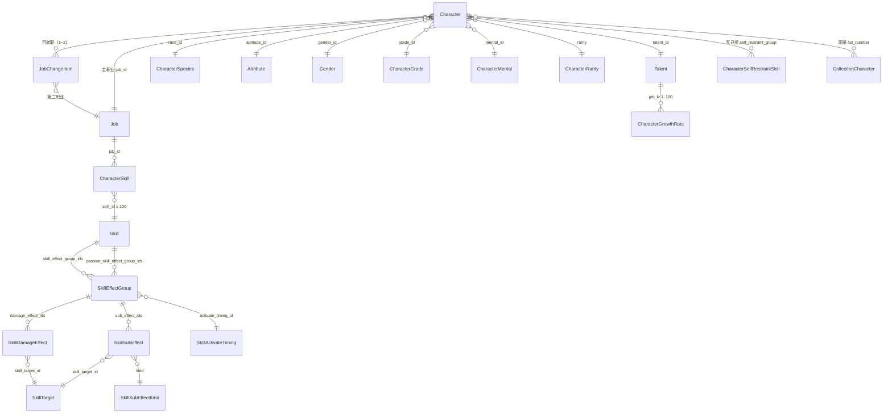

# 02 · 角色 / 职业 / 技能 域调研

> 本次调研范围：`Character`、`Job`、`Skill` 及其关联表与效果表。
> 所有数字均可由 `out\masterdata` 复现，脚本见附录 B。
> 证据等级：[已验证] 交叉验证 / 外键 100%；[推断] 语义或结构推断；[未知]。

---

## 1. TL;DR

| 对象 | 表 | 规模 | 结论 |
|---|---|---|---|
| 角色 | `Character` | 105 行 / 76 个角色组 | 一行 = 一个「风格」；组才是角色 |
| 职业 | `Job` | 17 行 | 9 常规 + 3 联动 + 4 角色专用 + 1 流浪者 |
| 角色↔职业 | `JobChangeItem` | 114 行 / 57 组 | 明确给出主职业 + 第二职业；另 19 组单职业 |
| 职业技能 | `CharacterSkill` | 420 行 / 266 技能 | 按角色等级 + 属性解锁 |
| 技能 | `Skill` | 8,655 行 / 3,031 identification | 玩家可获得 929 个；其余约 2,100 为敌方/测试 |
| 技能效果 | 3 张 unk 表 + 4 张已知表 | 约 2.3 万行 | 外键基本闭合，可出逐级数值 |

---

## 2. 领域模型



要点：

- **技能 ID 是两级的**：`identification`（技能本体）+ `level`（等级）；数据库主键 `id = identification*100 + level`。
- **等级数据完全外置**：每一级有自己的效果组 ID（`= 该级 Skill.id`），所以「逐级威力/消耗」不是公式，而是配置。
- **职业不直接持有技能**：职业的技能清单在 `CharacterSkill`，逐级效果在 `Skill`。

---

## 3. 角色

### 3.1 `Character` 字段分组

共 51 个字段，按用途分 7 组：

| 组 | 字段 | 说明 |
|---|---|---|
| 身份 | `id`、`character_group_id`、`name`、`caption_name`、`image_name`、`thumbnail_name` | `caption_name` = 风格名（基本/贪婪的圣女…） |
| 维度 | `rarity`、`race_id`、`gender_id`、`aptitude_id`、`alignment`、`alignment_point`、`personality_id`、`grade_id`、`mental_id` | 对应 6 张小字典表 |
| 职业 | `job_id` | 仅主职业；第二职业看 `JobChangeItem` |
| 技能 | `unique_skill_ids`、`skill_identification_1/2`、`sub_skill_identification_1/2`、`same_skill_identification_ids`、`exclude_inheritance_skill_ids`、`self_restraint_group`、`skill_get_lv`、`sub_inheritance_grade_id` | 见 §3.5 |
| 成长 | `talent_id` | 指向 `Talent`（83 种） |
| 隐退 | 无字段（走 `FateCharacterStatuses`） | 隐退后获得的「XX 的才能」，见 03 §4.7 |
| 风格/觉醒 | `is_default_style`、`before_awakening_character_id`、`awakening_character_id`、`show_style_name` | 见 §3.3 |
| 其他 | `favorite_inn_rank`、`favorite_liquor_id`、`liquor_*`、`reliability*`、`voice_group_id`、`speech`、`breakup_speech`、`event_group_id` 等 | 酒场/语音/剧情，暂不做 |

### 3.2 ID 编码（[已验证] 105/105）

```
1 0 1 1 0 0 4 3 0 0 0 0
│ │ │ │ └─┬─┘ └──┬──┘
│ │ │ │   │      └ 风格序号：0000 基本 / 0001 异装 / 0099 觉醒 / 0100 特殊
│ │ │ │   └ 序号（4 位）
│ │ │ └ 性别：1 男 / 2 女 / 3 无
│ │ └ 种族：1 人类 / 2 精灵 / 3 矮人 / 4 兽人 / 6 妖精；联动 0 Galka、1 Hume、2 Elvaan
│ └ 恒为 0；联动作 5（250/251/252）
└ 稀有度：1 一般（200）/ 2 传说（300）/ 8 无名（100）/ 9 流浪者
```

- `character_group_id` = 把 id 末 4 位清零。
- 由此可静态判断：稀有度、种族、性别、是否风格。

### 3.3 风格 / 觉醒 / 图鉴号

| 概念 | 判定方式 | 数量 |
|---|---|---|
| 角色组 | `character_group_id` | 76 |
| 基本风格 | id 末 4 位 `0000` | 76 |
| 异装风格 | `0001` | 20 |
| 觉醒风格 | `0099` | 8 |
| 特殊 | `0100` | 1（爱丽丝·邪神觉醒） |
| 有图鉴号 | `CollectionCharacter.list_number` 按 id 匹配 | 75 行 |
| 图鉴号空缺 | 29 个风格 + 1 个「？？？？」（Wanderer 901100720000） | 30 行 |

图鉴号 = `CollectionCharacter` 中 `category_select_id == Character.id` 的 `list_number`。
`CollectionCharacter` 另有 110 行 `category=other`（NPC/怪物），不属于角色域。

图鉴号实际分布（75 个组有号）：

| 区间 | 数量 | 含义 |
|---|---|---|
| 67 ~ 69 | 3 | 外传三人：伊亚玛斯、贝卡南、艾妮琪 |
| 2001 ~ 2069 | 69 | 主线/活动角色 |
| 9001 ~ 9006 | 3 | 无名/通用冒险者 |

> 注意：8 个无名冒险者里只有 3 个有图鉴号（其余共用/未收录），所以「75 个有号」≠「75 个有名角色」。

> 注意：**图鉴号只挂在 `0000` 基本风格上**，风格行没有独立图鉴号。这是「按组聚合」而非「按行聚合」的直接理由。

### 3.4 角色 → 职业（本次重要结论）

`Character.job_id` 只有 1 个职业，第二职业由 `JobChangeItem` 给出：

```
JobChangeItem { id, character_id, character_group_id, job_id, item_id, quantity, gold, start_at }
```

- 114 行 = 57 个角色组 × 2 个职业，**没有例外**。
- 76 − 57 = 19 个组没有 `JobChangeItem`（即只有 1 个职业）：
  - 8 个无名冒险者（`80x*` 前缀）
  - 3 个联动角色（`25x*`：赛德、五郎八、普利修）
  - 7 个普通/角色专用职业角色（卡米尔、贝卡南、爱莉安诺特、艾妮琪、菲利希娅、影狼、银莲）
  - 1 个「？？？？」（Wanderer）

单职业清单（19 组）：

| 组 id | 角色 | 职业 |
|---|---|---|
| 102208110000 | 卡米尔 | Healer |
| 201201110000 | 贝卡南 | 高大的法师（801） |
| 201204510000 | 爱莉安诺特 | Knight |
| 202202110000 | 艾妮琪 | 银发修女（802） |
| 202208630000 | 菲利希娅 | Healer |
| 204105330000 | 影狼 | Ninja |
| 206308510000 | 银莲 | Healer |
| 250100630000 | 赛德 | 巴斯图克的暗黑骑士（200） |
| 251201110000 | 五郎八 | 东之国的宫司（201） |
| 252202520000 | 普利修 | 塔布纳基亚的忌讳之子（202） |
| 801100220000 / 801106210000 / 801202110000 / 801205330000 / 802102630000 / 802203620000 / 803104420000 / 804201530000 | 8 个无名冒险者 | 战士 / 武士 / 僧侣 / 忍者 / 僧侣 / 法师 / 骑士 / 盗贼 |
| 901100720000 | ？？？？ | 流浪者（900） |

主/副判定：`Character.job_id` = 主职业，`JobChangeItem` 中另一个 = 第二职业。
[已验证] 与攻略站 93 条角色完全一致（含 `second_job_key` 字段）。

### 3.5 角色 → 技能（四类）

| 类型 | 来源字段 | 数量（去重 identification） | 攻略站字段名 |
|---|---|---|---|
| 固有技能 | `unique_skill_ids`（含等级位） | 152 个技能（151 个为 `194*` 前缀） | `unique_skill_keys` |
| 继承技能 | `skill_identification_1/2` | 143 | `inherit_skill_key` |
| 潜在继承 | `sub_skill_identification_1/2` | 30 | `potential_inherit_skill_key` |
| 克己技能 | `self_restraint_group` → `CharacterSelfRestraintSkill` | 95 | `discipline_skill_key` |

细节：

- `unique_skill_ids` 里存的是**行 ID**（`identification*100+level`），如 `19400204001` → 技能 `194002040` Lv1。清洗时要 `// 100`。
- `skill_identification_1` 与 `_2` 经常相同（如加斯顿两个都是 `110015030`），表示「继承技能槽 1/2」，不是两个不同技能。
- `sub_skill_identification_*` = 潜在继承技能，需 `sub_inheritance_grade_id` 解锁。
  验证：加斯顿 `sub_skill_identification_1 = 110000040`（不灭一击），攻略站 `potential_inherit_skill_key = immortal-strike`，一致。
- 克己组：`CharacterSelfRestraintSkill` 按 `group_id` 给若干级，每级有 `level`、`need_point`、`skill_identification`。加斯顿 855 行中占 4 级（100/200/500/800 点）。
- `same_skill_identification_ids` 表示「同 ID 技能不叠加/可共选」的约束，多数为空。
- `194*` 序列共 239 个 identification，其中 151 个被角色引用，**88 个未被任何角色引用**（未实装/敌方/剧情用），是否收录需要决策。

### 3.6 属性构成与成长（[已验证]）

游戏内「特性值」= 7 项：`str / int / pie / vit / agi / dex / luk`。
`Job`、`CharacterSpecies`、`Attribute`、`Gender`、`CharacterGrade` 五张表都提供 `base_*` 与（部分）`growth_*`，数值为 ×100 的整数（`57` = 0.57）。

清洗脚本 `character.py` 采用的组合（与攻略站一致）：

```
基础值 = CharacterSpecies.base_* + Attribute.base_* + CharacterGrade.base_* + Gender.base_*
         （10 点底数已含在 CharacterSpecies 里，所以人类基础值就是 10）
显示成长率 = CharacterSpecies.growth_* + Attribute.growth_*
职业成长率 = Job.growth_str … （单独展示，二者相加才是实际成长）
HP/MP/SP = CharacterSpecies.base_hp/mp/sp + growth_hp/mp/sp（职业另有 base/growth 与倍率）
```

校验结果（`python local_scripts\clean\character.py --check <slug>`）：

| 角色 | 基础值 7 项 | 成长率 7 项 |
|---|---|---|
| 加斯顿（gaston） | 11/10/10/13/10/12/10 **完全一致** | 13/11/13/16/11/14/11 **完全一致** |
| 菲利希娅（phyllisia） | 8/16/10/8/12/12/10 **完全一致** | 10/21/10/10/13/15/13 **完全一致** |

成长率的「随机部分」由 `Talent` 决定：

- `Talent`（83 行）：`min_*` / `max_*` 七项区间，名称如「力・超早熟(通常キャラ)」「知・晩成(伝説キャラ)」。
- `CharacterGrowthRate`（8,300 行 = 83 才能 × 100 个 `job_lv`）：每级的 `*_rate`，是「额外等级 / 成长率修正」曲线。
- `CharacterMental`：`mental` ∈ {100, 90, 80}，`add_talent_max`。
- `CharacterGrade`（12 档）：`max_lv` 20→130，`base_*` 每档 +0/+1/+2/+3/+4/+6/+8/+10/+12/+14/+16/+18，`growth_*` 全 0。

> 攻略站把基础值写成「10 + 职业 + 种族 + 属性 + 性别」，但解包显示**职业的 `base_*` 不计入角色基础值**（否则加斯顿应为 13 而非 11）。职业的基础/成长是另一套「职业面板」，用于计算 HP/MP/SP 与倍率。这一点已在 `character.py` 注释中记录并验证。

### 3.7 现有角色产物与缺口

`out\clean\character\`（105 JSON + index.json，75 条有 `guide_no`）已包含：
身份、稀有度/职业/属性/种族/性别/性格/精神/阶级/阵营、四类技能、才能 min/max、基础/成长/池、逐级成长率、图片/语音、`raw` 原始行。

缺口（按 wiki 需求）：

1. 只有主职业，没有第二职业（`JobChangeItem`）。
2. 没有风格聚合信息（哪些行属于同一角色、风格名）。
3. `passive_skill` / `discipline_tags`（现手工数据的字段）没有对应产出——需要从技能效果反推「克己加什么属性」。
4. `release_date` 手工有，解包主数据里没有（推测在 `Schedule`/`Gacha` 相关表，未调研）。
5. ~~`fate_type` 无直接字段~~ 已解决：`FateCharacterStatuses.default_skill_id` → `Skill 1930150xx`（「XX的才能」），105/105 覆盖，脚本已输出 `fate` 字段。

---

## 4. 职业

### 4.1 `Job`（17 行 / 48 字段）

| 字段组 | 字段 | 说明 |
|---|---|---|
| 身份 | `id`、`name`、`abbreviation`、`display_order` | `display_order` 决定常规职业排序 1~9 |
| 基础 | `base_str/int/pie/vit/agi/dex/luk/hp/mp/sp` | 职业面板底值 |
| 成长 | `growth_*`（同上 10 项，×100） | 如战士 `growth_str=57` |
| 倍率 | `attack_correction`、`magic_correction`、`divine_correction`、`defence_correction`、`magic_defence_correction`、`hit_correction`、`avoid_correction`、`resist_correction`、`initiative_correction`、`detection_correction`、`trap_remove_correction`、`trap_avoid_correction`、`mp_correction`、`sp_correction`、`exp_correction`、`hate_rate`、`hate_offset`、`wanted_capture_correction`、`trap_release_success_expand_rate`、`consume_trap_release_retry_hp` | 单位 %（120 = 1.20），与攻略站「职业倍率表」逐项一致 |
| 阵营 | `alignment_good/neutral/evil` | 布尔 |
| 行为 | `behaviour_job_id` | AI/演出用 |

常规 9 职业倍率（已与攻略站核对）：

| id | 职业 | atk | mag | div | def | mdef | acc | eva | res | spd | det | dtrap | etrap |
|---|---|---|---|---|---|---|---|---|---|---|---|---|---|
| 100 | 战士 | 120 | 50 | 60 | 105 | 90 | 100 | 90 | 100 | 90 | 90 | 90 | 90 |
| 101 | 盗贼 | 100 | 60 | 50 | 95 | 95 | 110 | 110 | 100 | 100 | 95 | 110 | 115 |
| 102 | 僧侣 | 90 | 90 | 120 | 100 | 110 | 90 | 80 | 110 | 90 | 100 | 90 | 90 |
| 103 | 法师 | 50 | 120 | 100 | 90 | 110 | 70 | 70 | 100 | 85 | 115 | 85 | 85 |
| 104 | 骑士 | 110 | 50 | 100 | 115 | 115 | 100 | 70 | 120 | 75 | 80 | 80 | 80 |
| 105 | 忍者 | 100 | 75 | 30 | 95 | 95 | 115 | 115 | 100 | 100 | 95 | 100 | 100 |
| 106 | 武士 | 100 | 100 | 60 | 95 | 95 | 100 | 90 | 100 | 85 | 60 | 60 | 60 |
| 107 | 游侠 | 100 | 75 | 30 | 90 | 90 | 130 | 85 | 100 | 90 | 125 | 80 | 120 |
| 108 | 治愈师 | 40 | 110 | 110 | 95 | 110 | 60 | 100 | 150 | 95 | 50 | 50 | 50 |

特殊职业（7 个）：`200/201/202` 联动（FFXI 风格名字）、`800/801/802/803` 角色专用、`900` 流浪者。它们**复用常规职业技能**（见 §4.3）。

### 4.2 `CharacterSkill`（420 行 / 17 个职业 / 266 个技能）

```
CharacterSkill { id, job_id, get_lv, aptitude_id, skill_id }
```

- `get_lv`：角色在该职业达到此等级时解锁。
- `skill_id`：技能**行 ID**（`identification*100+1`），取等级 1。
- `aptitude_id`：`999` = 无条件；`1~7` = 按属性（火/水/风/土/光/暗/无）给不同技能。

战士（100）17 个技能，等级 4/6/8/10/12/14/16/18/25/31/36/51/54/62/65/68/70；法师（103）62 条，其中 42 条是 `aptitude 1~7` 的属性分支（每个属性一套攻击魔法）。

> 清洗建议：`aptitude_id != 999` 的行表示「属性变体」，输出时应作为 `variants` 而非独立技能，否则同一技能会出现 7 次。

### 4.3 技能 ID 前缀与职业的对应（[已验证]）

```
前缀 = 110 + (job_id - 100)      // 仅常规 9 职业严格成立
100 → 110*   101 → 111*   102 → 112*   103 → 113*   104 → 114*
105 → 115*   106 → 116*   107 → 117*   108 → 118*
```

特殊职业的 `CharacterSkill` 会混用多个前缀：

| 职业 | 前缀构成 |
|---|---|
| 200 暗黑骑士 | `140*` ×9 + `110*` ×9（自带 9 个 + 战士 9 个） |
| 201 宫司 | `110*` ×10 + `140*` ×7 |
| 202 忌讳之子 | `140*` ×17（全自带） |
| 800 黑杖法师 | `113*` ×19 + `110*` ×6 |
| 801 高大的法师 | `113*` ×23 + `110*` ×10 + `194*` ×1 |
| 802 银发修女 | `112*` ×14 + `114*` ×5 + `113*` ×1 + `194*` ×1 |
| 803 黑杖武士 | `116*` ×17 + `194*` ×2 |
| 900 流浪者 | `110*` ×8 |

---

## 5. 技能

### 5.1 `Skill` 表结构（8,655 行 / 31 字段）

| 字段组 | 字段 | 说明 |
|---|---|---|
| 主键 | `id`、`identification`、`level` | `id = identification*100 + level`；`level` 可为 0 |
| 文本 | `name`、`description`、`detail_description`、`battle_start_passive_message` | 本地化对象；少数测试技能 `description` 是纯字符串 |
| 分类 | `skill_kind`、`skill_tag_ids`、`use_timing`、`range_type` | 见 §5.3 |
| 消耗 | `cost`、`cost_kind`、`skip_cost_consumption`、`use_limit` | 见 §5.3 |
| 归属 | `learnable_job_id`、`job_limited_ids`、`equipment_limited_ids` | 职业/装备限制 |
| 条件 | `skill_condition_ids`、`intelligence_*` | 条件 ID、智力分级下的替换技能 |
| 效果 | `skill_effect_group_ids`、`passive_skill_effect_group_ids` | 指向效果组（见 §5.4） |
| 其他 | `hate`、`is_failure`、`is_exclude_skill_list`、`is_failure` | 仇恨值、是否失败技能、是否从列表隐藏 |

文本完整度：`name` 8,318 行有本地化对象（94 行缺 `zhs`）；`description` 7,200 行是对象（1,455 行是纯日文测试串）；`detail_description` 7,118 行。

### 5.2 规模与「玩家可见」口径

| 口径 | identification 数 | 说明 |
|---|---|---|
| 全表 | 3,031 | 含敌方、测试、未实装 |
| 含 `level = 0` 行的技能 | 1,598（其中**只有** 0 级的 1,576 个） | 敌方技能/常驻被动 |
| 玩家可获得（脚本口径 `player = true`） | **929** | 角色四类 + 职业技能 + 装备/套装/遗物 + 缘角色羁绊 + 隐退才能 |
| 其中「核心」技能（不含羁绊/才能） | 853 | 角色/职业/装备/遗物/克己/套装 |
| 有中文名 | 929 / 929 | 玩家技能全部有中文名 |

929 的来源拆分（一个技能可被多个系统引用）：

| 来源 `sources` | 数量 |
|---|---|
| `job` 职业技能（`CharacterSkill`） | 266 |
| `unique` 固有技能（`unique_skill_ids`） | 152 |
| `equipment` 装备技能（`standard_skill_ids` / `attack_skill_id`） | 152 |
| `inherit` 继承技能（`skill_identification_1/2`） | 143 |
| `relic` 遗物技能（`RelicSkill`） | 122 |
| `discipline` 克己技能（`CharacterSelfRestraintSkill`） | 95 |
| `bond` 缘角色羁绊（`FateCharacterStatuses` 的 `Fate::Character` 65 + `FateAdditionalSkills` 4） | 69 |
| `potential` 潜在继承（`sub_skill_identification_*`） | 30 |
| `equip_set` 套装技能（`EquipSetSkills`） | 8 |
| `fate` 隐退才能（`FateCharacterStatuses` 的 `Character::Character`） | 7 |
| **并集** | **929**（= 853 + 69 + 7，无重叠） |

按类型分布（929）：

| skill_kind | 含义 | 数量 |
|---|---|---|
| 3 | 辅助技能（被动/主动增益） | 706 |
| 2 | 攻击技能（物理） | 101 |
| 4 | 攻击魔法 | 49 |
| 6 | 强化魔法 | 24 |
| 5 | 回复魔法 | 23 |
| 1 | 普通攻击 | 16 |
| 7 | 妨碍魔法 | 8 |
| 20 | 设置陷阱 | 2 |

等级上限分布（929）：7 级 358 个、1 级 227 个、6 级 122 个、9 级 95 个、5 级 86 个、0 级 17 个、4 级 8 个、15 级 8 个、3 级 5 个、2 级 3 个。

### 5.3 枚举推断

**`skill_kind`**（[已验证 5 类 / 推断 4 类]）
用攻略站 `skill_kind_type` 关键词与本地 `skill_kind` 做映射（120 个可直接对上的技能，零冲突）：

| 值 | 关键词 | 中文标签 | 置信度 |
|---|---|---|---|
| 1 | `normal-attack-skill-kind-type` | 普通攻击 | 高 |
| 2 | `attack-skill` | 攻击技能 | 高 |
| 3 | `support-skill` | 辅助技能 | 高 |
| 4 | `attack-magic` | 攻击魔法 | 高 |
| 7 | `disturbance-magic` | 妨碍魔法 | 高 |
| 5 | — | 回复魔法（迪欧斯/玛迪欧斯…） | 中（语义） |
| 6 | — | 强化魔法（素荣图/卡鲁狄亚…） | 中（语义） |
| 20 | — | 设置陷阱（捕兽夹/吊木桩） | 中 |
| 90 | — | 特殊（迷宫脱出道具、捕获率上升…） | 低 |

**`cost_kind`**（[未知]）

- 取值 1（8,588 行）/ 2（67 行）。
- `cost_kind=2` 多为高阶回复/复活类（死灰复燃、勇者之药），消耗 7~85；也有少量增益/妨碍技能。
- `cost_kind=1` 覆盖物理、魔法、被动（0 消耗）。
- 推断 1 = SP / 2 = MP 与数据不符（攻击魔法也是 1），更像是「默认 SP 池」，需实测确认。

**`use_timing`**（[推断]）

| 值 | 关联的 kind | 推断含义 |
|---|---|---|
| 1 | kind 3 为主（900） | 战斗开始 / 条件触发 |
| 2 | 全部主动技能 | 我方回合主动使用 |
| 3 | kind 20（14） | 探索时设置 |
| 4 | kind 5（98）、kind 90 | 回合结束 / 受击后 |
| 5 | kind 3（4,150，被动） | 常时被动 |
| 6 | kind 3/6（10） | 特殊触发 |
| 7 | kind 6（1） | 特殊触发 |

**其他枚举**

- `range_type`：0（6,495）/ 10（1,461）/ 99（625）/ 1（74）。用途未定，推测与射程/范围有关；真正的目标由 `SkillTarget` 给出。
- `alignment`：1 善 / 2 中立 / 3 恶 — **[已验证]** 93/93 角色。
- `rarity`：100 无名 / 200 一般 / 300 传说 — 名称来自 `CharacterRarity`。
- `CharacterGrade`：1 无阶（Lv20）… 12 奥利哈尔钢（Lv130）。

### 5.4 效果链路（本域最有价值的部分）

```
Skill.id (= ident*100+lv)
 ├─ skill_effect_group_ids[] ─────► SkillEffectGroup (unk_c506d12c17, 9,502 行)
 │                                   ├─ damage_effect_ids[] ─► SkillDamageEffect (2,024 行)
 │                                   │                          └─ skill_target_id ─► SkillTarget (157)
 │                                   ├─ sub_effect_ids[] ────► SkillSubEffect (unk_4369adef4d, 10,852)
 │                                   │                          ├─ kind ─► SkillSubEffectKind (unk_3cdcc01c30, 469)
 │                                   │                          └─ skill_target_id ─► SkillTarget
 │                                   ├─ turn_end_sub_effect_ids[]
 │                                   ├─ child_effect_group_id
 │                                   └─ activate_timing_id ─► SkillActivateTiming (228)
 └─ passive_skill_effect_group_ids[] ─► 同上（被动技能走这里）
```

外键闭合情况：

| 外键 | 引用 | 去重 | 命中 | 缺失 |
|---|---|---|---|---|
| `Skill.skill_effect_group_ids` | 7,707 | 7,675 | 7,675（100%） | 0 |
| `SkillEffectGroup.damage_effect_ids` | 2,133 | 2,009 | 2,003 | 6 |
| `SkillEffectGroup.sub_effect_ids` | 23,317 | 8,290 | 8,244 | 46 |
| `SkillEffectGroup.activate_timing_id` | 1,534 | 145 | 145（100%） | 0 |
| `SkillSubEffect.kind` | — | 461 | 461（100%） | 0 |
| `SkillSubEffect.skill_target_id` | — | 74 | 74（100%） | 0 |
| `SkillDamageEffect.skill_target_id` | — | 39 | 39（100%） | 0 |

逐级数值示例（战士「强袭」`110000000`，`SkillDamageEffect.attack_rate` 单位 %）：

| 等级 | SP | 效果组 | attack_rate | add_damage_rate |
|---|---|---|---|---|
| 1 | 5 | 11000000001 | 150 | 100 |
| 2 | 8 | 11000000002 | 160 | 100 |
| 3 | 12 | …003 | 175 | 100 |
| 4 | 15 | …004 | 185 | 100 |
| 5 | 23 | …005 | 200 | 100 |
| 6 | 28 | …006 | 210 | 100 |
| 7 | 40 | …007 | 225 | 100 |

> 结论：**「技能升级」本质是换一整套效果配置**，不是公式；因此只要把效果组按等级展开，就能得到完整的逐级表格。攻略站上「技能升级后威力上升」的描述可直接由 `detail_description` + `attack_rate` 双份数据支撑。

### 5.5 升级 / 点数 / 继承

| 表 | 行数 | 含义 |
|---|---|---|
| `SkillInheritance` | 2,407 | 继承技能的等级点数：`{skill_identification, level, need_point}`，如 100/300/600/1000…（每级递增）。405 个技能有数据，9 个引用在 `Skill` 中不存在 |
| `CharacterSelfRestraintSkill` | 855 | 克己技能：`{group_id, level, need_point, skill_identification, skill_level}` |
| `RelicSkillLevel` / `RelicSkillRemoveCost` | 10 / 18 | 遗物技能的等级与洗点成本 |
| `EquipSetSkills` | 8 | 套装技能，含 `max_skill_level` |
| `Skill.level` 上限 | — | 单技能最高 15 级（8 个）；`195015000` 有 50 级（异常，疑为测试） |

### 5.6 三个坑（清洗必看）

1. **引用格式不统一**：`Skill*` 表之间用「行 ID」，但 `Equipment.standard_skill_ids` 用「identification」，`Equipment.attack_skill_id` 又用「行 ID」；`Enemy.standard_skill_ids` 两种混用。**解析时要「先当行 ID 查，失败再当 identification 查」**。
2. **`~2` 不是同一张表**：`CharacterSelfRestraintSkill~2`（28 行）与 `CharacterSelfRestraintSkill`（855 行）字段不同，是两套 schema 同名。同理 `CharacterReplaceVoiceCondition~2`（12,952 行）、`GuestCharacterAi~2`（3,535 行）、`CharacterOutfit~2`（2 行）。
3. **测试数据大量混入**：`997801`~`999xxx` 是「毒耐性テスト」「凍結テスト」之类的开发占位；`level=0` 的 1,598 个技能多为敌方常驻。做产品时必须按 §5.2 的口径过滤。

---

## 6. 未命名表识别（本次产出）

方法：把字段集合归一化（去 `<X>k__BackingField`、去非字母数字、小写）后，与 IL2CPP 的 `Bone.MasterData.*` 类做 Jaccard 相似度，再用**外键闭合率**证伪。

| 表 | 行数 | 最近类（相似度） | 外键证据 | 结论 |
|---|---|---|---|---|
| `unk_c506d12c17` | 9,502 | `SkillEffectGroup` (0.789) | `Skill.skill_effect_group_ids` 7,675/7,675 命中；`activate_timing_id` 145/145 命中 | **SkillEffectGroup**（高置信） |
| `unk_4369adef4d` | 10,852 | `SkillSubEffect` (0.935) | `SkillEffectGroup.sub_effect_ids` 8,244/8,290 命中；`kind` 461/461、`skill_target_id` 74/74 命中 | **SkillSubEffect**（高置信） |
| `unk_3cdcc01c30` | 469 | `SkillSubEffectKind` (0.879) | `SkillSubEffect.kind` 全部命中本表 id；字段含 `param_1..7 / category / primary_category / effective_message` | **SkillSubEffectKind**（高置信） |
| `unk_32ab483534` | 102 | `EventMissionGroup` (0.750) | 含 `box_gauge_*`，与已知 `EventMissionGroup` 不是同一 schema | 疑似 `EventMissionBoxGaugeGroup`（未定） |
| `unk_cdd53404f8` | 25 | — | `condition_id` 全是 14 位角色 ID（如 20110461000000），文本为剧情条件说明 | 疑似角色条件说明表（未定） |
| `unk_1f6204bcb0` | 36 | `DispatchRewards`/`WantedReward` (0.5) | `difficulty_id + require_point + reward_group_id` | 疑似派遣/通缉难度奖励（未定） |
| `unk_cf90cffc86` | 36 | — | `difficulty_id + enemy_formation_id + order_number` | 疑似派遣敌人编队（未定） |
| `unk_cb564a94a5` | 23 | — | 仅 `position_1..6` | 疑似初始阵型（未定） |
| `unk_29eec6a855` | 12 | — | `fortress_id + position_num + recommended_combat_power` | 疑似要塞区域（未定） |
| `unk_3da7dc4ff9` | 1 | — | 活动任务组 / 剧本进度 | 疑似活动配置（未定） |
| `unk_c07b5bd50c` | 3 | — | `town_id + schedule_id` | 未定 |
| `unk_901a04e2df` | 160 | `EquipmentEffectUpgradeItem` (0.2) | `effect_id + initial/reinforce/refine_value` | 疑似装备效果成长（未定） |
| `unk_bd43fb2570` | 57 | `ScenarioMission` (0.429) | `scenario_progress_id + reward_group_id` | 疑似剧情任务（未定） |
| `unk_3132707639` | 1 | — | 异界玩家遭遇权重 | 未定 |
| `unk_d41d8cd98f` | 0 | — | 空表 | 忽略 |

落地方式（建议）：把上表前 3 行写进 `tools\clean\data\manual_names.json`（键 = sig），重跑 `identify_tables.py`，`out\masterdata` 就会输出 `SkillEffectGroup.json` 等真名。

---

## 7. 与现有手工数据 `public/data.json` 的映射

当前 `ISearcherExposeData` 结构（`src/views/DataSearcher/data/SearcherData.types.ts`）：

```
{ character[], characterRates[], jobMultiplier[], standardClass[], skill[], characterConfig{} }
```

| 手工字段 | 解包来源 | 迁移难度 |
|---|---|---|
| `name` / `name_jp` / `name_en` | `Character.name.{zhs,ja,en}` | 直接 |
| `class: string[]` | `Job.name.zhs`（主 + `JobChangeItem` 第二职业） | 直接 |
| `rarity` / `race` / `gender` / `element` / `personality` | 对应小表的 `name.zhs` | 直接 |
| `group` | `Character.character_group_id`（需重新编号） | 中 |
| `index` | `CollectionCharacter.list_number`（75 个有值） | 直接 |
| `passive_skill` | 需从 `unique_skill_ids` / `skill_identification_1` 里挑 | 中 |
| `inherit_skill` / `inherit_skill2` | `skill_identification_1/2` | 直接 |
| `unique_skill` | `unique_skill_ids // 100` | 直接 |
| `discipline_skill` / `discipline_tags` | `CharacterSelfRestraintSkill` + 效果反推 | 中（tags 需解析效果） |
| `fate_type` | `FateCharacterStatuses.default_skill_id` → `Skill 1930150xx`（「XX的才能」） | 直接（105/105 覆盖） |
| `release_date` | 主数据中未找到，需调研 `Schedule`/`Gacha` | 难 |
| `characterRates.*` | `Talent` + `CharacterGrowthRate` | 直接（但要确定「展示哪一级」） |
| `jobMultiplier.*` | `Job.*_correction` / 100 | 直接 |
| `standardClass` | `Job`（`display_order` 100~900 区间过滤） | 直接 |
| `skill[].name/description/type/category/cost_value/max_level/required_class` | `Skill` 的 `name/description/skill_kind/learnable_job_id/cost/max(level)/job_limited_ids` | 直接 |
| `skill[].upgrade_description` | `detail_description` | 直接 |
| `skill[].active_tags` / `passive_tags` | `skill_tag_ids`（仅 8 个取值）+ 效果类型 | 中 |
| `skill[].required_weapon_range` | `equipment_limited_ids`（装备类型 ID） | 中（需装备类型名） |

数量对比：角色 95 条（`data.json`）→ 105 行 / 76 组；技能 521 → 929（其中核心 853）；职业 14 → 17。

---

## 8. 验证记录（可直接复现）

| 校验项 | 方法 | 结果 |
|---|---|---|
| 角色基础值/成长率 | `character.py --check gaston / phyllisia` 对比 `out\reference\guide\*_character_*.json` 的 `statsData` | 7 项基础 + 7 项成长 **完全一致** |
| 阵营 | 93 条 codex 角色 vs 本地 `alignment` | **93/93 一致**（1 good / 2 neutral / 3 evil） |
| 种族 / 性别 / 属性 | 同上，关键词比对 | **93/93 一致** |
| 主+副职业 | codex `job_key` + `second_job_key` vs 本地 `job_id` + `JobChangeItem` | **一致**（57 组双职业、19 组单职业） |
| 职业倍率 | `Job.*_correction / 100` vs 攻略站「职业倍率表」 | 9 个常规职业 × 12 项**抽查全部一致** |
| 技能类型 | codex `skill_kind_type` vs `Skill.skill_kind` | 120 个可对上，**零冲突** |
| 技能效果外键 | 全表遍历 | 见 §5.4，主链路 100% |

---

## 9. 清洗输出设计（建议）

> 本节已按 2026-10-21 的决策（全量清洗、中文为主 + 日英名、技能全 3,031 个带标注、逐级数值先做高频类型）落地，脚本位于解包仓库：
> `tools\clean\common.py`、`character.py`、`job.py`、`skill.py`。

实际产物：

```
out\clean\
  character\                     (约 5.5 MB，108 个文件)
    index.json                   文件名 → id/组/图鉴号/三语名/风格
    characters.json              105 行平铺（含 raw）
    character_groups.json        76 个角色组（含 jobs / styles）
    <id>_<中文名>.json            每行一个（105）
  job\
    jobs.json                    17 个职业（92 KB）
  skill\                        (约 10 MB)
    skills.json                  3,031 个技能元数据（1.8 MB）
    skill_levels.json            identification → 逐级消耗/伤害/子效果（8 MB）
    effect_kinds.json            实际用到的 400 种效果类型 + 45 个中文标签（80 KB）
```

技能元数据（实际字段）：

```jsonc
{
  "identification": 110000000,
  "name": "强袭", "name_jp": "強撃", "name_en": "Heavy Attack",
  "kind": 2, "kind_name": "攻击技能",
  "max_level": 7, "is_passive": false,
  "description": "…", "detail_description": "…",   // 中文；缺失时标 description_lang
  "sources": ["job", "inherit"],                  // 被哪些系统引用
  "player": true,                                 // = sources 非空
  "jobs": [100],                                  // 可学习职业
  "job_limited": [], "equipment_limited": [110], "tags": [2],
  "flags": { "test": false, "level0": false, "player": true }
}
```

逐级数据（`skill_levels.json`，按 identification 分组）：

```jsonc
"110000000": [
  {
    "level": 1, "cost": 5, "cost_kind": 1, "use_timing": 2,
    "effect_group": 11000000001,
    "damage": [{ "attack_rate": 150, "add_damage_rate": 100, "damage_type": 1,
                 "fixed_damage": 0, "hit_rate": 0, "damage_count": 1,
                 "target": 901, "target_text": "…" }],
    "sub_effects": [{ "kind": 2000, "kind_name": "攻击力提升",
                      "strength": 20, "turn": 3, "target": 101, "target_text": "自身" }]
  }
]
```

角色（实际字段，`character_groups.json` 里的一组）：

```jsonc
{
  "character_group_id": 101100430000,
  "guide_no": 2013,
  "name": "加斯顿", "name_jp": "ガストン", "name_en": "Gaston",
  "rarity": { "id": 200, "name": "普通的冒险者", "name_jp": "…", "name_en": "…" },
  "race": { … }, "attribute": { … }, "gender": { … },
  "jobs": [
    { "id": 100, "name": "战士", "primary": true },
    { "id": 101, "name": "盗贼", "primary": false }
  ],
  "fate": { "identification": 193015000, "name": "力量的才能",
            "name_jp": "力の才能", "name_en": "Strength Talent", "type": "力量" },
  "styles": [{ "id": 101100430000, "caption": "基本", "is_default": true }],
  "default_style": 101100430000
}
```

单行文件（`<id>_<名>.json`）在此基础上还有：`names`（四语原对象）、`skills`（unique / inherit / potential_inherit / discipline + 所需点数）、`talent`（min/max）、`stats`（base/growth/pools/growth_rate 1~100）、`images`、`voice`、`raw`。

**「95 个角色」已核对完毕**（详见 [`03-manual-vs-unpack.md`](./03-manual-vs-unpack.md) §0）：

```
95  = 75 个基本角色（含 8 无名）+ 20 个异装风格（0001）
    = 攻略站 93 条 + 爱莉安诺特 + 夏莉莉妮雅第二版
105 = 95 + 8 个觉醒风格（0099）+ 1 个邪神觉醒（爱丽丝 0100）+ 1 个占位（？？？？流浪者）
```

手工 95 条与解包 95 行 1:1 完全匹配，因此索引主键可以直接用「角色组 + 风格」二元组。

---

## 10. 风险与未解

| 风险 | 说明 | 缓解 |
|---|---|---|
| 枚举语义缺失 | `cost_kind`、`use_timing`、`range_type`、`skill_kind 5/6/20/90` 无官方名 | 用行为特征 + 攻略站标签交叉，标注置信度；不要在前端硬编码文案 |
| 效果类型 469 种 | `SkillSubEffectKind` 的 `param_1..7` 含义需要逐个反推（如「攻击力+20%持续3回合」） | 先做 Top 20 高频类型，覆盖 80% 技能 |
| 数据版本漂移 | 游戏更新会加表/加字段，`sig` 变化即表名可能回退成 `unk_` | `tools/clean/data/*.json` 持久化 + 每次更新后 diff |
| 本地化缺失 | 部分表 `zht`/`ja` 为 null；94 个技能缺中文名 | 输出时回退链 `zhs → ja → en` |
| 敌方技能混表 | `Skill` 中 1,598 个 level 0 | 按 §5.2 口径过滤，或单独产出 enemy 域 |
| 测试数据 | `997801~999xxx`、`195015000`（50 级） | 黑名单 + `is_exclude_skill_list` |

---

## 11. 首轮清洗结果（2026-10-21）

三个脚本已跑通并自校验，产物见 §9。

| 域 | 产物 | 规模 | 完整度 |
|---|---|---|---|
| 角色 | `out\clean\character\` | 105 行 / 76 组 / 75 图鉴号 / 29 风格 | 105 行全部解析出职业/种族/属性；57 组双职业 |
| 职业 | `out\clean\job\jobs.json` | 17 个职业 | 全部有基础/成长/12 项倍率；17 个都挂到技能 |
| 技能 | `out\clean\skill\` | 3,031 个 / 8,655 行等级 | 玩家可获得 929、测试 82、仅 0 级 1,576；2,001 行有伤害、6,942 行有子效果 |

已知缺口（均在产物中显式标注，不静默丢失）：

| 项 | 数量 | 标记 |
|---|---|---|
| 技能无名（敌方占位，名称为空串） | 5 | `name = "# <identification>"` |
| 技能描述回退日文 | 1,648（其中玩家技能 23） | `description_lang = "ja"` |
| 效果类型无中文标签 | 355 种（共 400 种被使用） | `kind_name` 回退日文原名 |
| 效果标签覆盖率 | 玩家技能 89.5%（122 / 414 个 kind 有中文名，45 个带参数位语义） | `effect_kinds.json` 的 `labeled` / `params` 字段 |

脚本自校验：

- `character.py --check gaston` / `phyllisia`：基础值、成长率仍与攻略站完全一致（改造后复跑通过）。
- `job.py`：17 个职业全部解析，战士 17 个技能、盗贼 24、僧侣 29（与 `CharacterSkill` 行数一致）。
- `skill.py`：`Skill.skill_effect_group_ids` 引用 100% 命中；`skill_levels.json` 的键数量 = 3,031。

---

## 附录 A · 本域相关表清单（32 张）

**角色**：`Character`、`CharacterSpecies`、`CharacterRarity`、`CharacterGrade`、`CharacterGradeGrowth`、`CharacterMental`、`CharacterGrowthRate`、`CharacterGrowthExp`、`Talent`、`CharacterSelfRestraintSkill`、`CharacterSelfRestraintSkill~2`、`CharacterFacial`、`CharacterFusionBonus`、`CharacterOutfit`、`CharacterOutfit~2`、`CharacterModelResource`、`CollectionCharacter`、`Gender`、`Attribute`、`Personality`、`CharacterReplaceVoiceCondition(~2)`、`CharacterVoice*`、`FateCharacterStatuses`、`FateSkillLevel`、`FateAdditionalSkills`

**职业**：`Job`、`JobChangeItem`、`JobVoiceGroup`

**技能**：`Skill`、`CharacterSkill`、`SkillGroup`、`SkillInheritance`、`SkillTarget`、`SkillActivateTiming`、`SkillActivateTimingCondition`、`SkillDamageEffect`、`SkillDefence`、`SkillEffectGroupOverrideAsset`、`SkillStepReplace`、`SkillSubEffectExtensionParam`、`EquipSetSkills`、`EquipSetSkillContents`、`RelicSkill`、`RelicSkillLevel`、`RelicSkillRemoveCost`、`FateAdditionalSkills`、`FateSkillLevel`、`unk_c506d12c17`、`unk_4369adef4d`、`unk_3cdcc01c30`

## 附录 B · 复现命令

```bat
cd /d D:\WizardyDaphne\WizardyDaphneUnpack

:: 表清单 / 规模
python -X utf8 -c "import json;d=json.load(open('out/masterdata/index.json',encoding='utf8'));print(len(d),sum(v['records'] for v in d.values()))"

:: 角色产物（在本仓库根目录执行）
python local_scripts\clean\character.py

:: 未命名表分诊
python tools\clean\analyze_unk.py

:: 单表查看
python tools\masterdata.py --find skill
```

本文档中的所有统计口径（929 / 76 / 57 / 2,003 …）均来自对 `out\masterdata` 的遍历脚本，若游戏更新，重跑即可复核。
